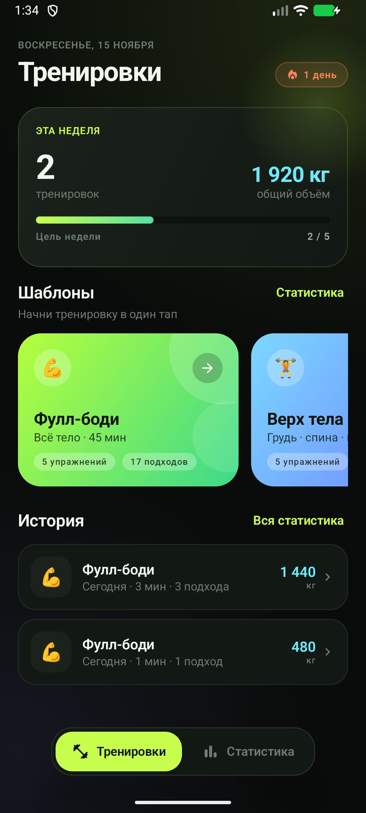
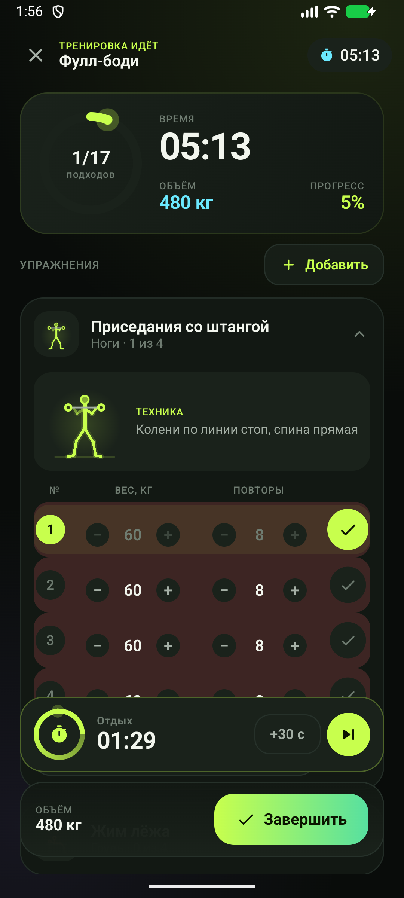
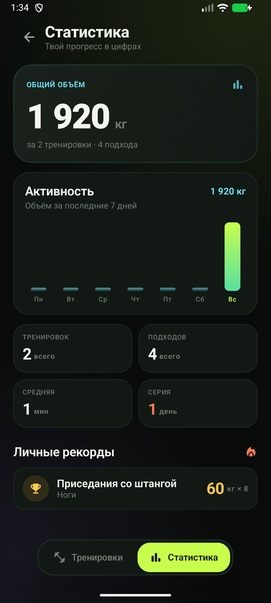

# Rep — трекер тренировок

Android-приложение на Kotlin + Jetpack Compose: быстрый лог силовых тренировок с анимациями, жестами и локальным хранением данных.

## Возможности

- **Готовые шаблоны**: фулл-боди, верх тела, низ тела, кардио + кор.
- **Активная тренировка**: таймер, кольцо прогресса, карточки упражнений с раскрытием, шаг веса/повторов, отметка подходов с хаптиком и пружинной анимацией.
- **Анимированные фигуры упражнений**: у каждого движения своя Canvas-анимация (присед, жим, тяга, подтягивания, планка и т.д.) и подсказка по технике.
- **Свайп для удаления** подхода.
- **Таймер отдыха** на 90 секунд с продлением на +30 и пропуском.
- **Добавление упражнений** из каталога (18 упражнений) через bottom sheet с поиском.
- **Сворачивание тренировки**: черновик сохраняется и восстанавливается с главного экрана.
- **Итоги тренировки**: конфетти на Canvas, анимированное кольцо с галочкой, объём/время/подходы, разбивка по упражнениям.
- **Статистика**: столбчатый график за 7 дней, недельная цель, серия, личные рекорды.
- **История** тренировок на главном экране.
- Полностью русский интерфейс, тёмная неоновая тема.

## Скриншоты

| Главная | Тренировка | Статистика |
| --- | --- | --- |
|  |  |  |

## Структура

```
app/src/main/java/com/fitrep/app/
├── data/            # модели, каталог упражнений и шаблонов, хранилище, статистика, форматирование
├── ui/
│   ├── components/  # ProgressRing, GradientButton, WeekBarChart, StatTile, ValueStepper, BottomNav
│   ├── screens/     # Home, Workout, Summary, Stats
│   ├── theme/       # цвета, типографика, формы
│   └── RepApp.kt     # ручная навигация и диалоги
└── MainActivity.kt
```

## Сборка и запуск

Требуется JDK 17+ (проверено на JBR 21) и Android SDK 35.

```powershell
$env:JAVA_HOME = "$env:USERPROFILE\.jdks\jbr-21.0.11"
.\gradlew.bat :app:assembleDebug
```

APK: `app/build/outputs/apk/debug/app-debug.apk`.

Установка на запущенный эмулятор/устройство:

```powershell
adb install -r app\build\outputs\apk\debug\app-debug.apk
adb shell am start -n com.fitrep.app/.MainActivity
```

Проект собран в офлайн-режиме (`--offline`), зависимости зафиксированы под локальный Gradle-кэш.
